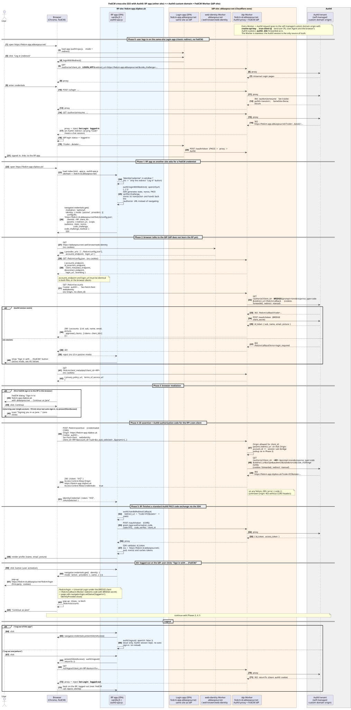

# FedCM cross-site SSO for Auth0 with Cloudflare Workers

A proof of concept for **silent SSO between two unrelated top-level domains**, using the browser's
[FedCM API](https://developer.chrome.com/docs/identity/fedcm/overview) in front of an Auth0 tenant.

The user signs in once on the IdP's site. An app on a *different* site then signs them in through a browser-mediated
FedCM prompt, and after the first sign-in it does so automatically with no clicks. The two sites share no cookies,
and it works with third-party cookies blocked, which is exactly where the classic hidden-iframe `prompt=none`
check breaks down.

Auth0 doesn't speak FedCM natively. Here a Cloudflare Worker, which already acts as the reverse proxy for Auth0's
**self-managed custom domain**, also implements the FedCM IdP endpoints. It translates each FedCM request into a
server-side `/authorize?prompt=none` call against the user's existing Auth0 session. The relying party (RP) uses the
stock [`auth0-spa-js`](https://github.com/auth0/auth0-spa-js) SDK and ends up with ordinary Auth0 tokens from a
standard PKCE code exchange.

## Components

| Role                                                   | Reference deployment                     | Code                   |
|--------------------------------------------------------|------------------------------------------|------------------------|
| Auth0 tenant                                           | `fedcm-demo.au.auth0.com`                | `tf/`                  |
| **IdP site**: the eTLD+1 that owns the IdP             | `abbaspour.net`                          |                        |
| FedCM well-known file, at the apex of the IdP site     | `abbaspour.net/.well-known/web-identity` | `workers/web-identity` |
| **IdP domain**: Auth0 custom domain + FedCM endpoints  | `fedcm-id.abbaspour.net`                 | `workers/idp`          |
| **Login app**: same site as the IdP, redirect login    | `fedcm-app.abbaspour.net`                | `apps/spa`             |
| **RP app**: a different site, signs in with FedCM      | `fedcm-app.slipbox.uk`                   | `apps/spa` (same code) |

Both apps are a single vanilla-JS static site. `config.js` picks the behaviour by hostname: a classic redirect login
on the IdP's site, FedCM on the other site.

## Sequence



Source: [`docs/fedcm-sequence.puml`](docs/fedcm-sequence.puml). Run `make diagram` to re-render it. CI fails if
the committed SVG is stale.

### How the RP gets its tokens

1. The RP calls `auth0.loginWithRedirect({ openUrl })`. The SDK builds a normal PKCE authorization request and stores
   its transaction, but hands the URL back to the app instead of navigating.
2. The app passes `state`, `nonce`, `code_challenge`, `redirect_uri`, `scope` and so on as FedCM `params` to
   `navigator.credentials.get()`.
3. The browser fetches the well-known file and `config.json`. It then calls the accounts endpoint with the IdP's
   cookies, and the Worker asks Auth0 who is logged in (see [the bridge app](#the-bridge-app)).
4. After "Continue as …", or automatic re-authentication for returning users, the browser POSTs to the
   ID assertion endpoint. The Worker validates the RP's Origin, then runs `/authorize?prompt=none` **for the RP's own
   client** with the RP's PKCE challenge. It returns the resulting Auth0 authorization code as the FedCM token.
5. The RP calls `auth0.handleRedirectCallback(redirect_uri + '?code=…&state=…')`. The SDK redeems the code at
   `/oauth/token` with its PKCE verifier and validates the ID token, whose issuer is the custom domain.

The Worker never sees the RP's tokens. It only handles a PKCE-bound code that is useless without the RP's verifier.

### The bridge app

FedCM deliberately omits `client_id` and Origin from the accounts request, so the IdP can't tell which site is asking.
Auth0 also has no "session cookie → user" API. So the Worker owns a confidential Auth0 Regular Web App, the
*bridge*, and uses it to:

- **Look up the account.** The Worker runs `/authorize?client_id=BRIDGE&prompt=none` with the browser's `auth0`
  cookie, redeems the code with the bridge secret, and maps `sub`, `name`, `email` and `picture` from the ID token to
  a FedCM account. It returns 401 if there's no session.
- **Run the login pop-up.** The FedCM `login_url` (`/fedcm/login`) runs Universal Login under the bridge client.
  `/fedcm/callback` then calls `navigator.login.setStatus('logged-in')` and `IdentityProvider.close()`.

Bridge tokens never leave the Worker. Each account lookup shows up as a silent-auth event in the Auth0 logs.

### IdP login status

FedCM expects the IdP to tell the browser when the user logs in or out. The Worker adds this header to proxied Auth0
responses:
- `Set-Login: logged-in` on any Auth0 redirect that carries `?code=`, which means a live session exists.
- `Set-Login: logged-out` on `/v2/logout` and `/oidc/logout`, or when the `auth0` cookie is cleared.

The IdP status page (`/` on the IdP domain) and `/fedcm/callback` also call `navigator.login.setStatus()`.

### Two Workers, duplicated endpoint config

- `workers/web-identity` serves only the well-known file. It has no secrets; its only setting is `IDP_ORIGIN`.
- `workers/idp` is the Auth0 reverse proxy plus every FedCM endpoint, including `config.json`.

The endpoint URLs are deliberately duplicated in both, and browsers reject the sign-in unless the well-known
`accounts_endpoint` and `login_url` match `config.json` exactly. Two guards catch drift:
- `make test` (offline) catches path drift.
- `make check` (live, runs at the end of `make deploy`) catches both path and hostname drift.

## Prerequisites

- An Auth0 tenant on a plan that includes **custom domains with self-managed certificates**.
- An Auth0 Machine-to-Machine app authorised for the Management API with read/create/update/delete on `clients`,
  `client_keys`, `connections`, `users` and `custom_domains`. Terraform uses it.
- Two Cloudflare zones on different eTLD+1s: one for the IdP site, one for the RP app.
  - The **apex of the IdP zone must have a proxied (orange-cloud) DNS record**, or the well-known route never
    receives traffic. Either proxy the existing apex record or set `create_apex_record = true`.
  - Cloudflare credentials for Terraform (DNS) and `wrangler login` for Workers, routes and custom domains.
- `terraform` (≥ 1.5), `wrangler` (v4), `node` (≥ 22), `jq`, and `plantuml` (only to re-render the diagram).

## Deploy

```bash
cp tf/terraform.auto.tfvars.example tf/terraform.auto.tfvars   # credentials, demo user, topology

make -C tf          # terraform plan, saved to tf/tfplan (default goal)
make -C tf apply    # apply the saved plan: custom domain + TXT verification, 3 clients, connection, user, DNS
make test           # offline Worker tests against a mocked Auth0
make deploy         # web-identity Worker -> gen config -> IdP Worker -> secrets -> both apps -> make check
make tail           # live IdP Worker logs
```

- `make infra` runs plan and apply in one go.
- Each piece can also be deployed on its own with `make deploy-web-identity`, `make deploy-idp` or `make deploy-apps`.
- `scripts/gen-config.sh` writes the non-secret runtime config (client IDs, Auth0 origin) from the Terraform outputs
  into git-ignored files. `make secrets` sets the Worker secrets (`CNAME_API_KEY`, `BRIDGE_CLIENT_SECRET`) from the
  same outputs.

`tf/terraform.auto.tfvars` and the Terraform state contain secrets and are git-ignored. Keep them out of the repo.

## Adapting to your own domains

Hostnames are set explicitly in a few places rather than generated. To deploy under your own domains, change all of
these to match one another:

| What                            | Where                                                                                   |
|---------------------------------|-----------------------------------------------------------------------------------------|
| Auth0 tenant                    | `tf/terraform.auto.tfvars`: `auth0_domain`                                              |
| IdP site, IdP domain, app hosts | `tf/terraform.auto.tfvars`: `idp_zone`, `idp_domain`, `login_app_host`, `rp_app_host`   |
| IdP Worker route                | `workers/idp/wrangler.toml`: `routes` (`pattern` and `zone_name`)                       |
| Well-known route and IdP origin | `workers/web-identity/wrangler.toml`: `routes` and `IDP_ORIGIN`                         |
| App custom domains              | `apps/spa/wrangler.toml`: `[env.*]` routes (rename the envs in the root `Makefile` too) |
| Live checks                     | `scripts/check.sh` defaults, or pass `-d`, `-w` and `-a`                                |
| FedCM button label              | `apps/spa/public/index.html`: `#login-fedcm`                                            |

The diagram and this README use the reference deployment's hostnames. After changing them, run `make test`. After
deploying, `make check` confirms the hostnames agree end to end.

## Demo script

Use Chrome with third-party cookies blocked, and keep each app's event log visible.

1. **Logged out:** open the RP app. The passive FedCM call is rejected without any UI. Click
   **Sign in with … (FedCM)**, sign in in the pop-up, click **Continue**, and the profile appears.
2. **SSO:** click **Log out everywhere**, log in on the Login app (classic redirect), then open the RP app. The first
   FedCM sign-in shows a "Continue as …" dialog, then the profile.
3. **Seamless return:** reload the RP app at least 10 minutes after the last automatic sign-in. The browser signs you
   in with only a toast, and the event log shows `isAutoSelected: true`.
4. **Logout:**
   - *Log out of this app* calls `preventSilentAccess()`, so a reload doesn't sign you back in automatically.
   - *Log out everywhere* ends the Auth0 session, so the next FedCM call gets a 401.
5. **Fallback:** in a browser without FedCM, the redirect login still works.

`make check` runs smoke checks against the live hosts:
- the well-known file and `config.json` agree;
- the Auth0 issuer is the custom domain, which proves the proxy works;
- the accounts endpoint returns 401 without a session;
- both apps are serving.

## Caveats

- **Browser support:** FedCM is Chromium-only today (Chrome, Edge). Other browsers use the redirect fallback.
- **First sign-in:** zero-click sign-in only applies to returning users. The first FedCM sign-in to an RP in a given
  browser always needs one click.
- **Login status on redirects:** the Worker sets `Set-Login` on Auth0's 302 responses. The `setStatus()` pages are
  the fallback if a browser ignores it there.
- **Cookies on back-channel calls:** the Worker doesn't forward `Set-Cookie` headers that Auth0 returns on its
  server-side `prompt=none` calls.
- **End-user IP:** Auth0 attack protection sees the end user's IP through `true-client-ip` on Worker requests.
  Check the IPs in your tenant logs.
- **Purpose:** this is a demo, not a production IdP. All apps are first-party, and `approved_clients` lists every
  demo client.

## Repository layout

```
tf/                       Terraform: Auth0 custom domain, clients, connection, demo user; Cloudflare DNS
workers/web-identity/     /.well-known/web-identity on the IdP site's apex
workers/idp/              Auth0 reverse proxy + FedCM IdP endpoints (/fedcm/*)
apps/spa/                 Login app and RP app (one static site, two deployments)
scripts/                  gen-config.sh, check.sh (live smoke checks), check-diagram.sh
tests/                    offline Worker tests (mocked Auth0)
docs/                     sequence diagram (PlantUML source + rendered SVG)
```

## Teardown

```bash
terraform -chdir=tf destroy
for w in fedcm-idp fedcm-web-identity fedcm-app-abbaspour fedcm-app-slipbox; do wrangler delete --name "$w"; done
```

## License

[MIT](LICENSE)
